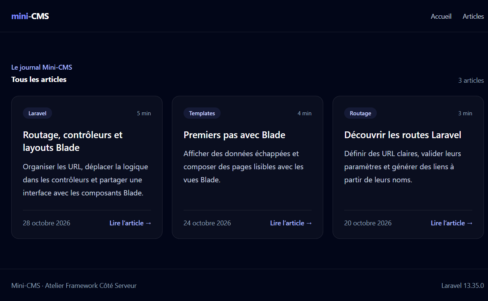
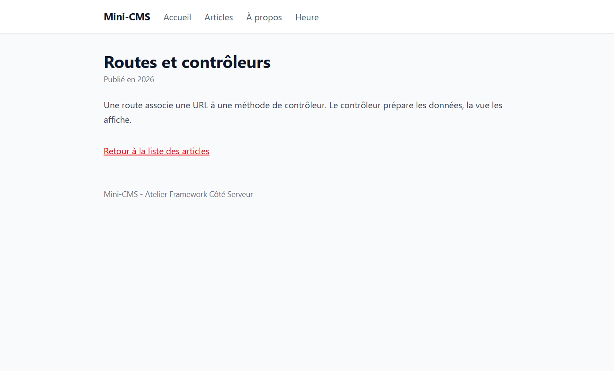
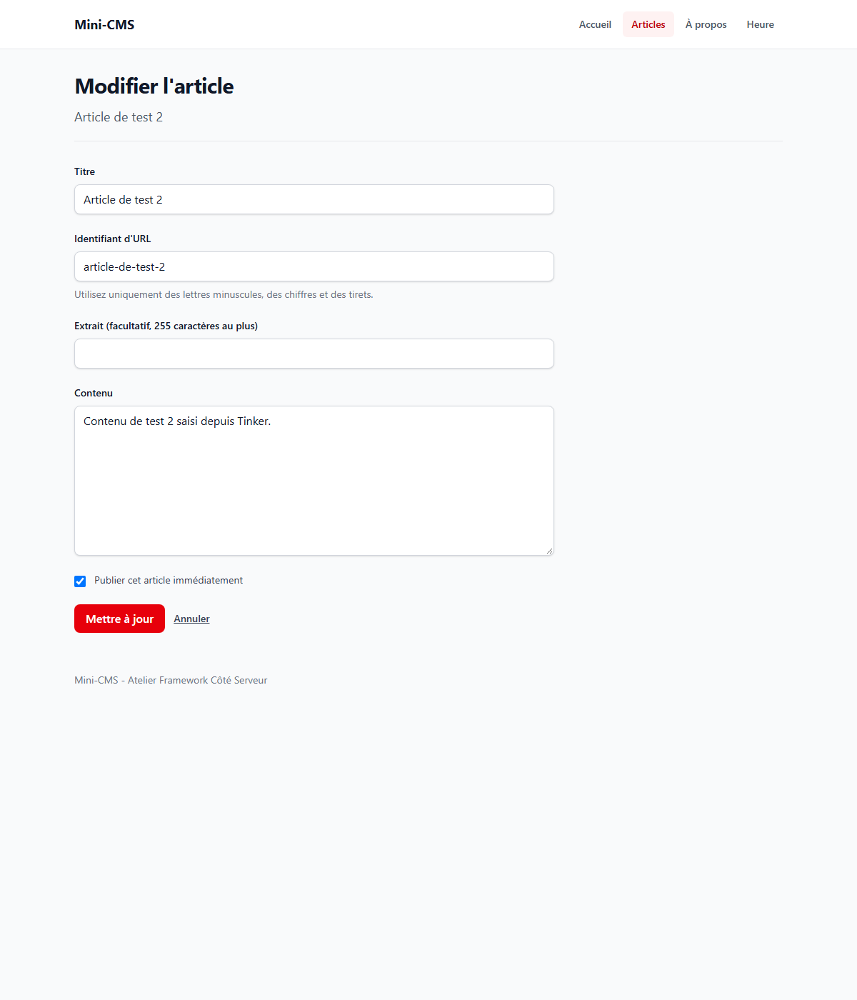
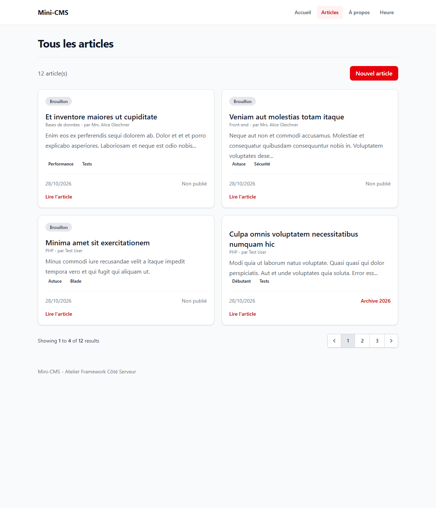

# Mini-CMS

## Description

Mini-CMS est une application pédagogique construite avec Laravel 13 et SQLite.
Elle présente la gestion d'articles, de catégories et de tags, ainsi qu'une API
JSON protégée par des jetons Sanctum pour ses opérations d'écriture.

État de ce dépôt : Mini-CMS livré jusqu'au tag `lab-08b` (sessions 14 et 15).

## Fonctionnalités

- Inscription, connexion et déconnexion par session sur le site.
- Rôles `author` et `admin`, contrôle d'accès avec `PostPolicy` et Gates.
- Création, modification, publication et suppression d'articles.
- Gestion des catégories et des tags depuis le back-office administrateur.
- API de lecture paginée des articles, catégories et tags, avec filtres par slug.
- Connexion API par jeton Sanctum et révocation du jeton courant.
- Création, modification et suppression d'articles par API, avec les mêmes
  Form Requests et règles d'autorisation que le site.
- Chargement anticipé et prévention du lazy loading en développement.
- Suite de tests Pest couvrant le site, les autorisations et l'API.

## Installation

### Bash

```bash
git clone https://github.com/azizdely/laravel-app.git mini-cms
cd mini-cms
composer install
npm install
cp .env.example .env
touch database/database.sqlite
php artisan key:generate
php artisan migrate:fresh --seed
npm run build
php artisan test
```

### PowerShell

```powershell
git clone https://github.com/azizdely/laravel-app.git mini-cms
Set-Location mini-cms
composer install
npm install
Copy-Item .env.example .env
if (-not (Test-Path database\database.sqlite)) {
    New-Item database\database.sqlite -ItemType File
}
php artisan key:generate
php artisan migrate:fresh --seed
npm run build
php artisan test
```

Pour démarrer l'application et Vite :

```bash
composer run dev
```

Ouvrez ensuite <http://localhost:8000>.

## Comptes de test

| Rôle | Adresse e-mail | Mot de passe |
|---|---|---|
| Administrateur | `test@example.com` | `password` |
| Auteur | Compte auteur créé par le seeder | `password` |

## API

Toutes les réponses d'erreur de l'API sont au format JSON. Les articles de la
liste sont publiés uniquement. Un article individuel brouillon est accessible
à son auteur et à un administrateur selon `PostPolicy`.

### Endpoints

| Méthode | URI | Authentification | Résultat |
|---|---|---|---|
| GET | `/api/posts?per_page=10&category=<slug>&tag=<slug>` | Aucune | Articles publiés paginés et filtrés |
| GET | `/api/posts/{post}` | Aucune pour un article publié | Détail d'un article |
| POST | `/api/login` | Aucune | Émet un jeton Bearer |
| POST | `/api/logout` | Jeton Bearer | Révoque le jeton courant |
| GET | `/api/user` | Jeton Bearer | Profil authentifié |
| POST | `/api/posts` | Jeton Bearer | Crée un article |
| PUT/PATCH | `/api/posts/{post}` | Jeton Bearer et autorisation | Modifie un article |
| DELETE | `/api/posts/{post}` | Jeton Bearer et autorisation | Supprime un article |
| GET | `/api/categories` | Aucune | Catégories et nombre d'articles publiés |
| GET | `/api/categories/{category}` | Aucune | Une catégorie et son nombre d'articles publiés |
| GET | `/api/tags` | Aucune | Tags et nombre d'articles publiés |
| GET | `/api/tags/{tag}` | Aucune | Un tag et son nombre d'articles publiés |

`per_page` accepte une valeur de 1 à 50. Les filtres `category` et `tag`
attendent les slugs existants ; les filtres sont conservés dans les liens de
pagination. Les identifiants `{post}` utilisent le slug de l'article.

### Authentification par jeton

Envoyez `POST /api/login` avec un corps JSON contenant `email` et `password`.
La réponse `201` contient le jeton en clair une seule fois. La base ne conserve
que son empreinte. Pour les routes protégées, envoyez :

```text
Authorization: Bearer VOTRE_JETON
Accept: application/json
```

Ne publiez jamais un vrai jeton dans le dépôt, une capture ou l'historique
Postman. `POST /api/logout` révoque le jeton présenté par la requête.

### Codes d'erreur

| Code | Signification |
|---|---|
| `200` | Lecture réussie ou modification réussie |
| `201` | Article ou jeton créé |
| `204` | Article supprimé ou jeton révoqué |
| `401` | Jeton manquant, invalide ou révoqué |
| `403` | Utilisateur authentifié non autorisé pour cet article |
| `404` | Article, catégorie ou tag introuvable |
| `422` | Données invalides, slug de filtre inconnu ou identifiants incorrects |

### Exemple curl.exe

La déconnexion renvoie `204` sans corps. Remplacez `VOTRE_JETON` par un jeton
obtenu avec `POST /api/login` :

```powershell
curl.exe -X POST -H "Accept: application/json" -H "Authorization: Bearer VOTRE_JETON" http://localhost:8000/api/logout
```

## Captures d'écran

Les captures d'écran existantes sont conservées dans [`screenshots/`](screenshots/).

### Interface du Mini-CMS











### Session 14 — preuves Postman à ajouter

Ajouter les captures réelles `screenshots/s14-postman-201.png` (création avec
jeton, réponse `201`) et `screenshots/s14-postman-403.png` (modification d'un
article appartenant à un autre auteur, réponse `403`). Ne pas capturer l'onglet
Authorization ni la réponse de connexion contenant le jeton.

## Choix d'architecture

### Pourquoi les écritures de l'API passent par PostPolicy

La `PostPolicy` est la règle commune au site et à l'API : une modification ou
une suppression est permise au propriétaire de l'article ou à un
administrateur. Réutiliser cette règle évite qu'un nouveau point d'entrée API
offre plus de droits que l'interface web.

### Pourquoi preventLazyLoading est activé

Une relation utilisée dans une boucle sans chargement anticipé peut déclencher
une requête supplémentaire par article (problème N+1). En développement,
`Model::preventLazyLoading` rend cet oubli visible ; les listes chargent donc
explicitement leurs auteurs, catégories et tags.

### Pourquoi l'API utilise des jetons et non la session

Un client comme Postman ou une application mobile n'utilise pas la session web
et son cookie. Le jeton Bearer accompagne chaque requête protégée et permet de
révoquer uniquement l'accès associé à ce jeton, sans déconnecter les autres
appareils.
