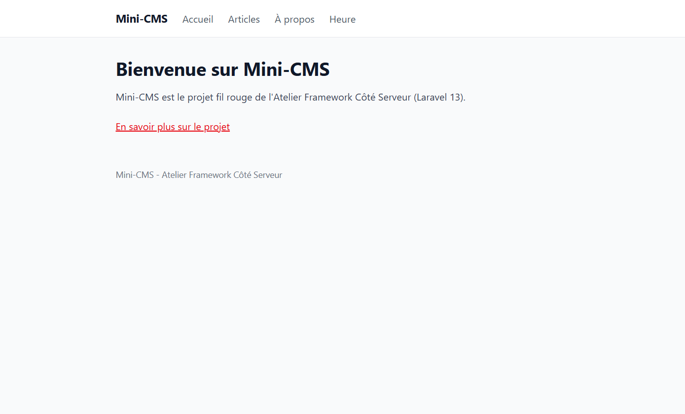
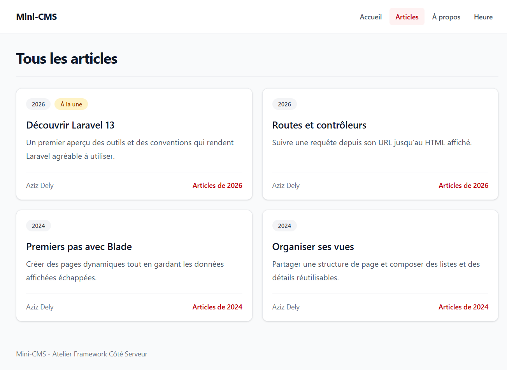
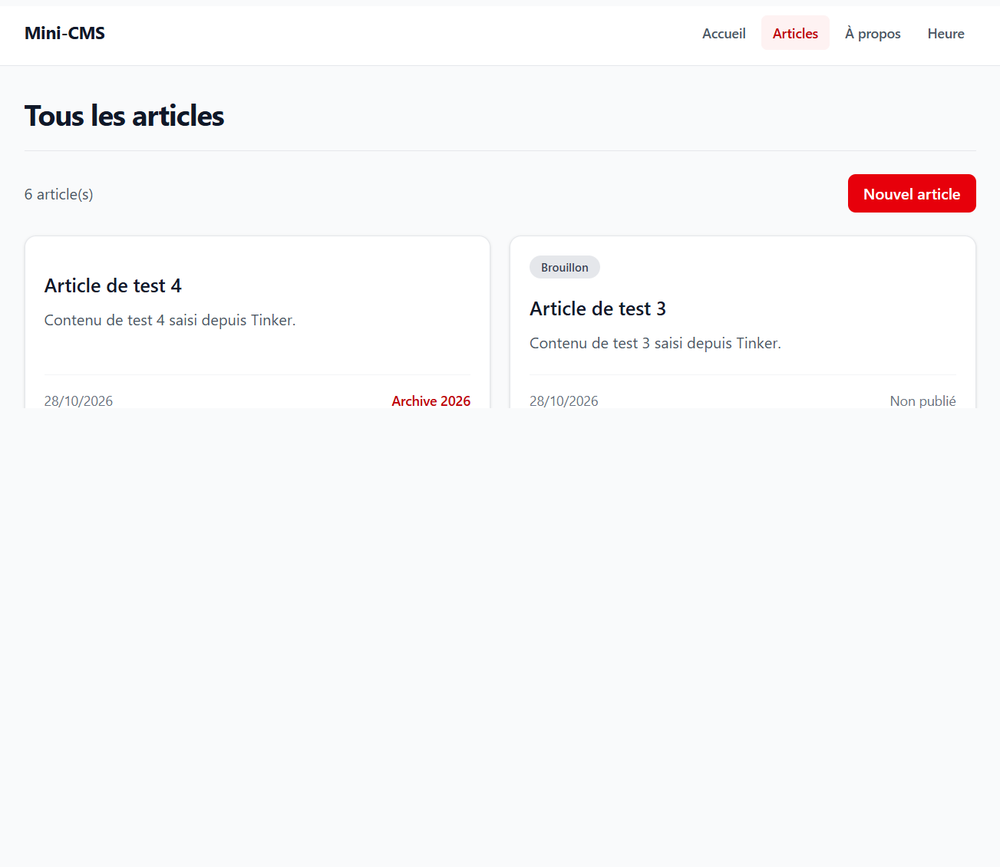
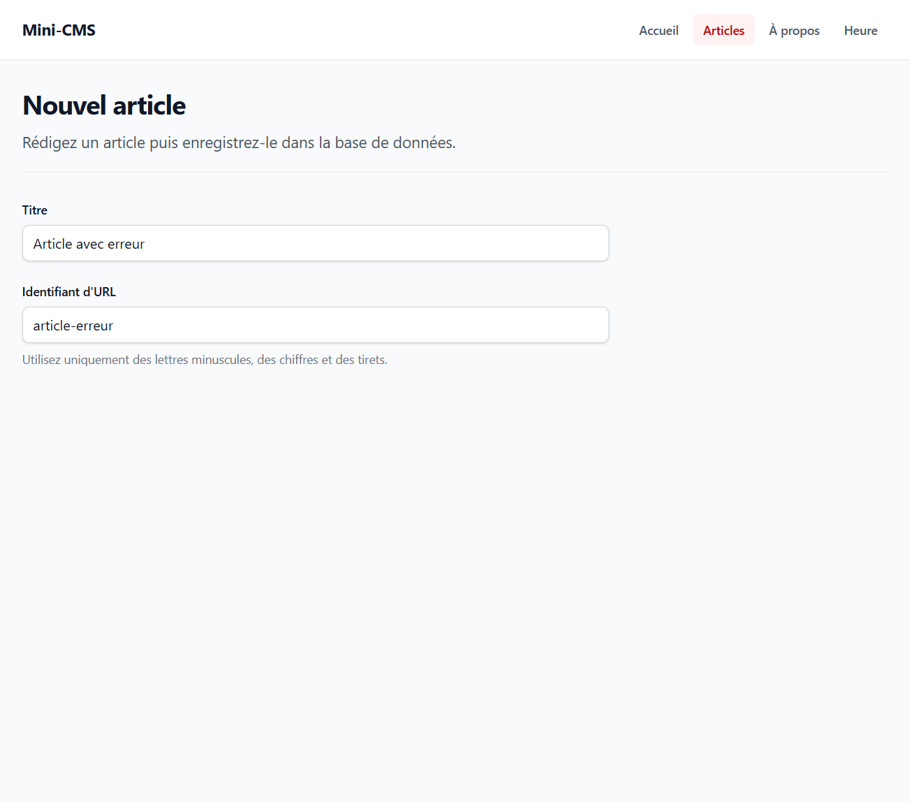

# Mini-CMS

Application pédagogique construite avec Laravel 13 pour l'Atelier Framework Côté Serveur.

## Installation

```powershell
git clone https://github.com/azizdely/laravel-app.git
cd laravel-app
composer install
npm install
copy .env.example .env
php artisan key:generate
New-Item database\database.sqlite -ItemType File
php artisan migrate
```

Démarrez les serveurs Laravel et Vite avec `composer run dev`, puis ouvrez <http://localhost:8000>.

## État actuel (tag lab-05b)

- Back-office des catégories et des tags sous `/admin` (`CategoryController`, `TagController`), protégé par le middleware `writable`, avec Form Requests et messages flash.
- Messages de validation en français (`lang/fr/validation.php`, `APP_LOCALE=fr`), avec des noms de champs lisibles et des messages propres aux slugs de catégories et de tags.
- Pages 404 et 503 affichées dans le layout du site ; les pages d'articles et de catégories introuvables proposent des liens utiles.
- Tests Pest : `PostPagesTest`, `PostWriteTest`, `PostRelationsTest`, `PostTaxonomyTest`, `PostFeedbackTest`, `CategoryAdminTest`, `TagAdminTest` et `ErrorPagesTest`.

## Données de démonstration

Après un clone, reconstruire la base avec `php artisan migrate:fresh --seed`. Attention : cette commande vide la base avant de la remplir.

## Routes disponibles

| Méthode | URI | Nom | Action |
|---|---|---|---|
| GET | `/` | `home` | `PageController@home` |
| GET | `/a-propos` | `about` | `PageController@about` |
| GET | `/heure` | `time` | `PageController@time` |
| GET | `/posts/archive/{year}` | `posts.archive` | `PostController@archive` |
| GET | `/posts/categorie/{category:slug}` | `posts.category` | `PostController@byCategory` |
| GET | `/posts/tag/{tag:slug}` | `posts.tag` | `PostController@byTag` |
| GET | `/posts` | `posts.index` | `PostController@index` |
| GET | `/posts/create` | `posts.create` | `PostController@create` |
| POST | `/posts` | `posts.store` | `PostController@store` |
| GET | `/posts/{post}` | `posts.show` | `PostController@show` |
| GET | `/posts/{post}/edit` | `posts.edit` | `PostController@edit` |
| PUT/PATCH | `/posts/{post}` | `posts.update` | `PostController@update` |
| DELETE | `/posts/{post}` | `posts.destroy` | `PostController@destroy` |
| PATCH | `/posts/{post}/publication` | `posts.publication` | `PostController@togglePublication` |
| GET | `/admin/categories` | `admin.categories.index` | `CategoryController@index` |
| GET | `/admin/categories/create` | `admin.categories.create` | `CategoryController@create` |
| POST | `/admin/categories` | `admin.categories.store` | `CategoryController@store` |
| GET | `/admin/categories/{category}/edit` | `admin.categories.edit` | `CategoryController@edit` |
| PUT/PATCH | `/admin/categories/{category}` | `admin.categories.update` | `CategoryController@update` |
| DELETE | `/admin/categories/{category}` | `admin.categories.destroy` | `CategoryController@destroy` |
| GET | `/admin/tags` | `admin.tags.index` | `TagController@index` |
| GET | `/admin/tags/create` | `admin.tags.create` | `TagController@create` |
| POST | `/admin/tags` | `admin.tags.store` | `TagController@store` |
| GET | `/admin/tags/{tag}/edit` | `admin.tags.edit` | `TagController@edit` |
| PUT/PATCH | `/admin/tags/{tag}` | `admin.tags.update` | `TagController@update` |
| DELETE | `/admin/tags/{tag}` | `admin.tags.destroy` | `TagController@destroy` |

## Captures

### Accueil avec le layout



### Liste des articles


### Détail d'un article


### Liste avec composants Blade



### Liste paginée depuis SQLite



### Formulaire de création



### Modification d'un article


### Confirmation de suppression


### Session 07


### Session 10

Back-office des catégories et des tags, validation en français, et pages 404/503 dans le layout. Les captures d'écran de cette séance restent à prendre depuis un navigateur.
