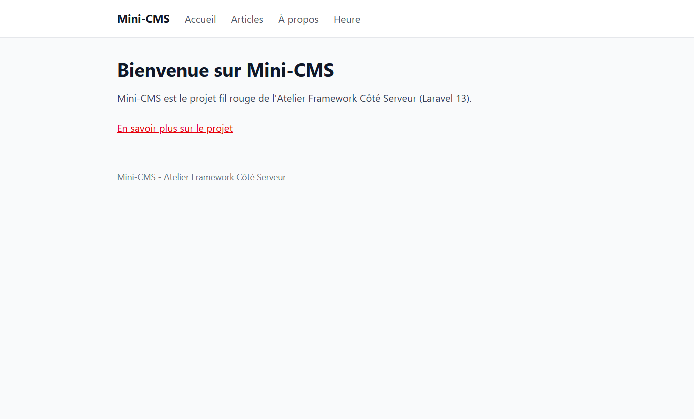
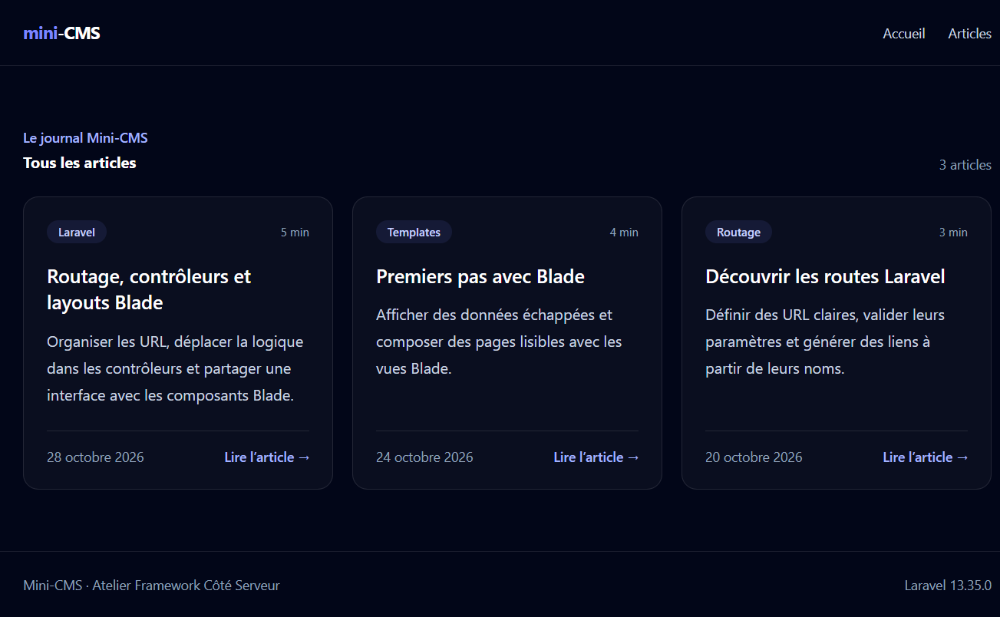
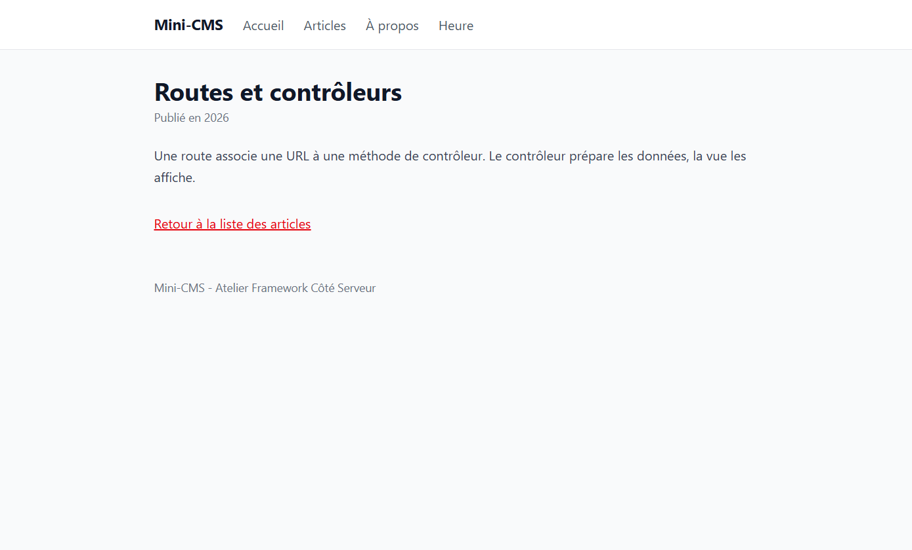
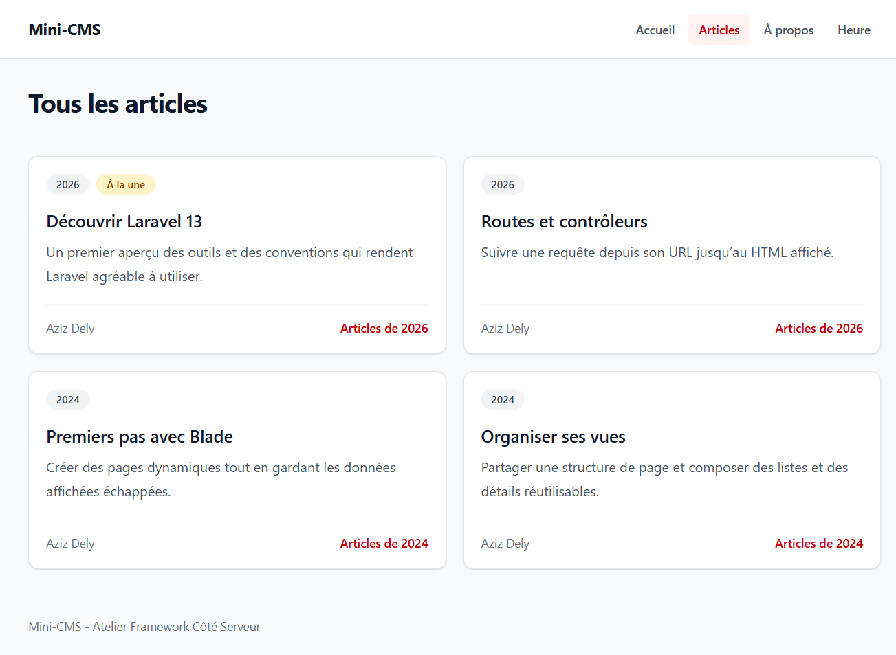

# Mini-CMS

Application pédagogique construite avec Laravel 13 pour l'Atelier Framework Côté Serveur.

## Installation

```powershell
git clone https://github.com/azizdely/laravel-app.git
cd laravel-app
composer install
npm install
copy .env.example .env
php artisan key:generate
New-Item database\database.sqlite -ItemType File
php artisan migrate
```

Démarrez les serveurs Laravel et Vite avec `composer run dev`, puis ouvrez <http://localhost:8000>.

## État actuel (tag lab-02b)

- Routes nommées, toutes servies par des contrôleurs : `PageController` (pages) et `PostController` (articles).
- Articles stockés dans un tableau PHP, sans base de données pour l'instant.
- Layout Blade `<x-layout>` et composants réutilisables `x-alert`, `x-navigation-link`, `x-navbar`, `x-post-card` et `x-page-header`.
- Navigation active accessible, archives par année, et pages d'accueil, de liste et de détail construites à partir de routes nommées.
- Base de données SQLite locale (`database/database.sqlite`, non versionnée).

## Routes disponibles

| Méthode | URI | Nom | Action |
|---|---|---|---|
| GET | `/` | `home` | `PageController@home` |
| GET | `/a-propos` | `about` | `PageController@about` |
| GET | `/heure` | `time` | `PageController@time` |
| GET | `/posts` | `posts.index` | `PostController@index` |
| GET | `/posts/archive/{year}` | `posts.archive` | `PostController@archive` |
| GET | `/posts/{slug}` | `posts.show` | `PostController@show` |

## Captures

### Accueil avec le layout



### Liste des articles



### Détail d'un article



### Liste avec composants Blade


