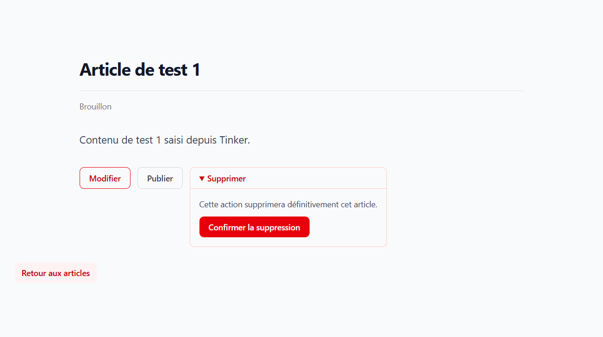
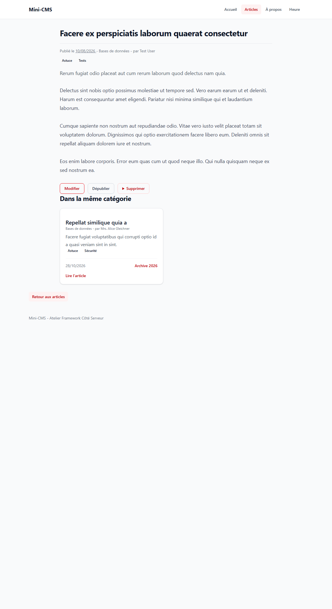

# Mini-CMS

Application pédagogique construite avec Laravel 13 pour l'Atelier Framework Côté Serveur.

## Installation

```powershell
git clone https://github.com/azizdely/laravel-app.git
cd laravel-app
composer install
npm install
copy .env.example .env
php artisan key:generate
New-Item database\database.sqlite -ItemType File
php artisan migrate
```

Démarrez les serveurs Laravel et Vite avec `composer run dev`, puis ouvrez <http://localhost:8000>.

## État actuel (tag lab-06)

- Inscription, connexion et déconnexion manuelles avec mots de passe hachés, régénération de session et messages flash.
- Colonne `role` (`author` par défaut, `admin` pour le compte de démonstration `test@example.com` créé par le seeder).
- Les écritures et le back-office demandent une session authentifiée ; les nouveaux articles sont liés à leur auteur.
- Gate `manage-categories` et `PostPolicy` : un auteur gère ses articles, un administrateur tous les articles.
- Pages « Mes articles » et option « Se souvenir de moi » disponibles après connexion.
- Tests Pest : sessions d'authentification, contrôle de propriété, CRUD des catégories/tags et pages d'erreur inclus.

## Données de démonstration

Après un clone, reconstruire la base avec `php artisan migrate:fresh --seed`. Attention : cette commande vide la base avant de la remplir.

## Routes disponibles

| Méthode | URI | Nom | Action |
|---|---|---|---|
| GET | `/` | `home` | `PageController@home` |
| GET | `/a-propos` | `about` | `PageController@about` |
| GET | `/heure` | `time` | `PageController@time` |
| GET | `/posts/archive/{year}` | `posts.archive` | `PostController@archive` |
| GET | `/posts/categorie/{category:slug}` | `posts.category` | `PostController@byCategory` |
| GET | `/posts/tag/{tag:slug}` | `posts.tag` | `PostController@byTag` |
| GET | `/posts` | `posts.index` | `PostController@index` |
| GET | `/posts/create` | `posts.create` | `PostController@create` |
| POST | `/posts` | `posts.store` | `PostController@store` |
| GET | `/posts/{post}` | `posts.show` | `PostController@show` |
| GET | `/posts/{post}/edit` | `posts.edit` | `PostController@edit` |
| PUT/PATCH | `/posts/{post}` | `posts.update` | `PostController@update` |
| DELETE | `/posts/{post}` | `posts.destroy` | `PostController@destroy` |
| PATCH | `/posts/{post}/publication` | `posts.publication` | `PostController@togglePublication` |
| GET | `/admin/categories` | `admin.categories.index` | `CategoryController@index` |
| GET | `/admin/categories/create` | `admin.categories.create` | `CategoryController@create` |
| POST | `/admin/categories` | `admin.categories.store` | `CategoryController@store` |
| GET | `/admin/categories/{category}/edit` | `admin.categories.edit` | `CategoryController@edit` |
| PUT/PATCH | `/admin/categories/{category}` | `admin.categories.update` | `CategoryController@update` |
| DELETE | `/admin/categories/{category}` | `admin.categories.destroy` | `CategoryController@destroy` |
| GET | `/admin/tags` | `admin.tags.index` | `TagController@index` |
| GET | `/admin/tags/create` | `admin.tags.create` | `TagController@create` |
| POST | `/admin/tags` | `admin.tags.store` | `TagController@store` |
| GET | `/admin/tags/{tag}/edit` | `admin.tags.edit` | `TagController@edit` |
| PUT/PATCH | `/admin/tags/{tag}` | `admin.tags.update` | `TagController@update` |
| DELETE | `/admin/tags/{tag}` | `admin.tags.destroy` | `TagController@destroy` |
| GET | `/inscription` | `register` | `Auth\RegisterController@create` |
| POST | `/inscription` | `register.store` | `Auth\RegisterController@store` |
| GET | `/connexion` | `login` | `Auth\LoginController@create` |
| POST | `/connexion` | `login.store` | `Auth\LoginController@store` |
| POST | `/deconnexion` | `logout` | `Auth\LoginController@destroy` |
| GET | `/mes-articles` | `my-posts` | `PostController@myPosts` |

## Comparaison avec le starter kit Livewire

| Fonction | Mini-CMS (authentification manuelle) | Starter kit Livewire |
|---|---|---|
| Routes d'authentification | Définies dans `routes/web.php` | Enregistrées par Fortify |
| Inscription | `RegisterController` et `RegisterRequest` | Fortify et action `CreateNewUser` |
| Connexion | `LoginController` avec `Auth::attempt()` | Fortify |
| Déconnexion | `Auth::logout()`, invalidation de session et nouveau jeton CSRF | Action Livewire de déconnexion |
| Limitation des tentatives | Non implémentée | Limiteur d'authentification intégré |
| Mot de passe oublié | Non implémenté | Fonctionnalité Fortify |
| Vérification de l'e-mail | Non implémentée | Fonctionnalité Fortify optionnelle |
| Double authentification | Non implémentée | Fonctionnalité Fortify optionnelle |
| Rôles et autorisations | Rôles, Gate et `PostPolicy` | À implémenter par l'application |
| Tests | Tests Pest dédiés | Tests Pest/PHPUnit du starter kit |

Dans un vrai projet, je garderais le starter kit pour ses fonctions d'authentification éprouvées, comme la limitation des tentatives, la récupération du mot de passe et la vérification d'adresse e-mail. Les rôles et les autorisations métier resteraient spécifiques au projet.

## Captures

### Accueil avec le layout


### Liste des articles


### Détail d'un article


### Liste avec composants Blade


### Liste paginée depuis SQLite


### Formulaire de création


### Modification d'un article


### Confirmation de suppression



### Session 07




### Session 10

Back-office des catégories et des tags, validation en français, et pages 404/503 dans le layout. Les captures d'écran de cette séance restent à prendre depuis un navigateur.

### Session 11

Comptes, connexion, navigation selon l'état de connexion et autorisations par rôle et propriété d'article. Les captures d'écran de cette séance restent à prendre depuis un navigateur.
