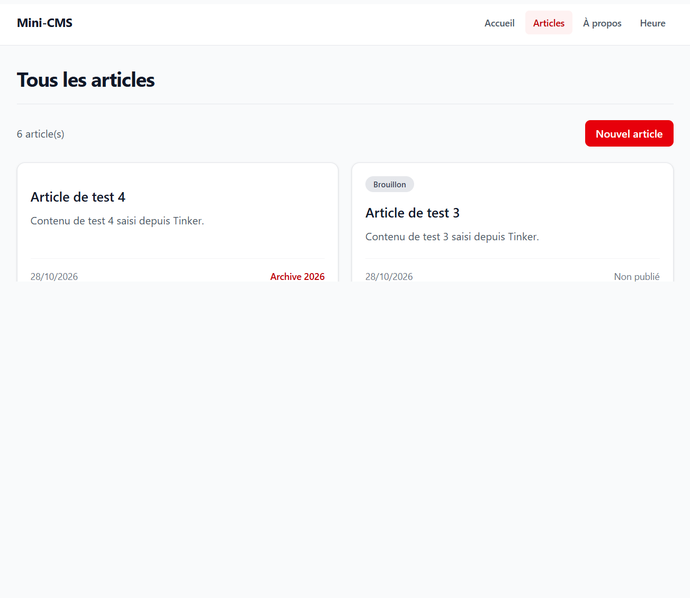
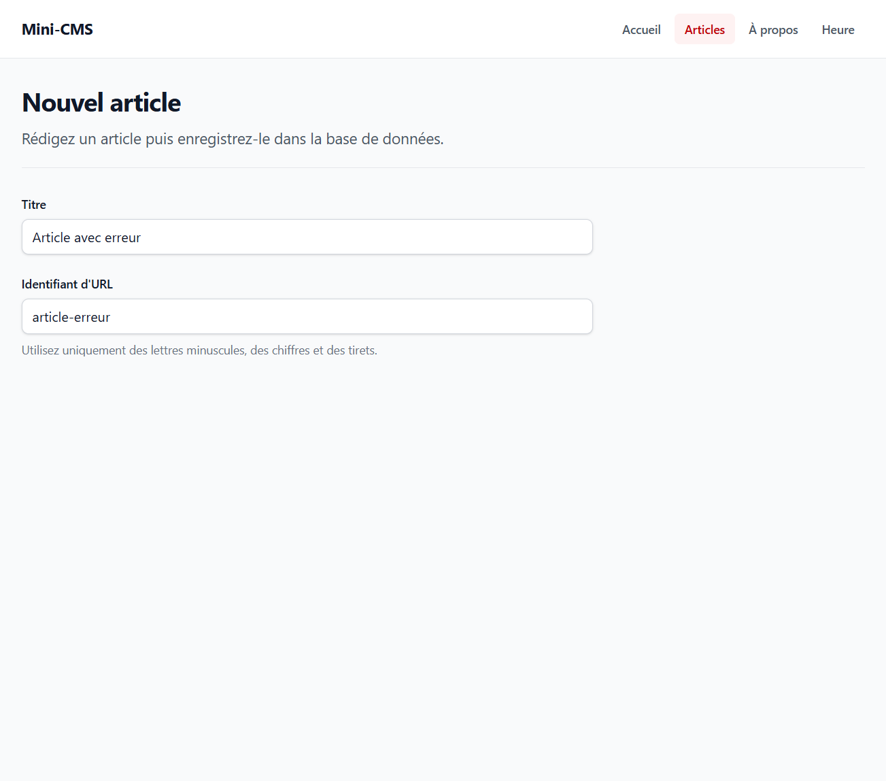
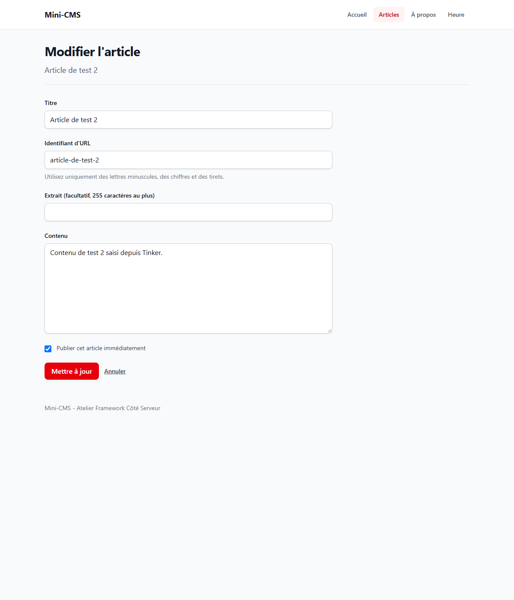
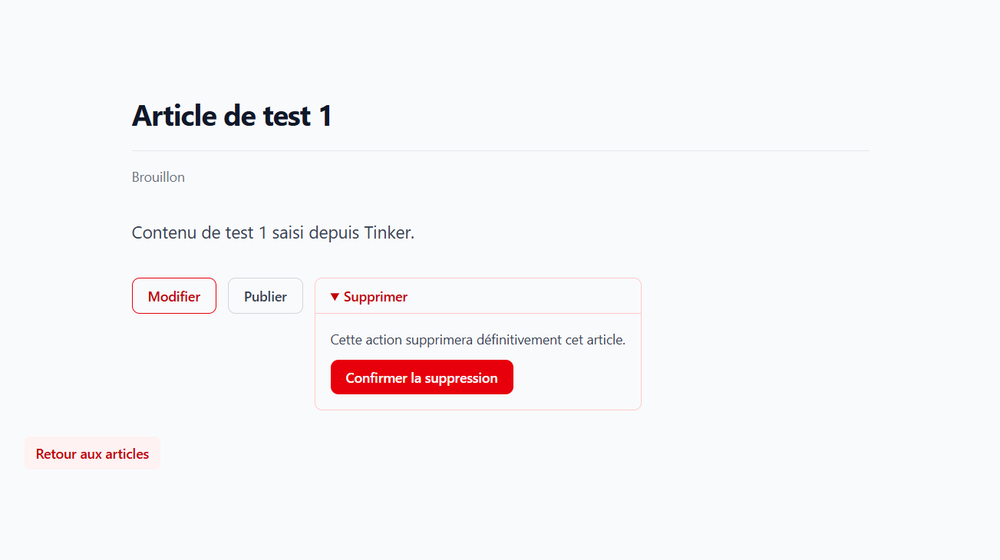

# Mini-CMS

Application pédagogique construite avec Laravel 13 pour l'Atelier Framework Côté Serveur.

## Installation

```powershell
git clone https://github.com/azizdely/laravel-app.git
cd laravel-app
composer install
npm install
copy .env.example .env
php artisan key:generate
New-Item database\database.sqlite -ItemType File
php artisan migrate
```

Démarrez les serveurs Laravel et Vite avec `composer run dev`, puis ouvrez <http://localhost:8000>.

## État actuel (tag lab-03b)

- Articles persistés dans SQLite et lus avec le modèle Eloquent `Post`.
- La migration `create_posts_table` crée les champs `title`, `slug`, `body`, `is_published` et `published_at`.
- Une migration distincte ajoute l'extrait facultatif `excerpt` sans modifier la migration initiale.
- La liste est paginée, le détail utilise la liaison modèle-route par slug et les articles peuvent être créés, modifiés et supprimés.
- Le scope `Post::published()` centralise le filtre de publication; le bouton dédié permet de publier ou dépublier un article.
- L'accueil affiche les trois articles publiés les plus récents.
- Layout Blade `<x-layout>` et composants réutilisables `x-alert`, `x-navigation-link`, `x-navbar`, `x-post-card` et `x-page-header`.
- Base de données SQLite locale (`database/database.sqlite`, non versionnée).

## Routes disponibles

| Méthode | URI | Nom | Action |
|---|---|---|---|
| GET | `/` | `home` | `PageController@home` |
| GET | `/a-propos` | `about` | `PageController@about` |
| GET | `/heure` | `time` | `PageController@time` |
| GET | `/posts/archive/{year}` | `posts.archive` | `PostController@archive` |
| GET | `/posts` | `posts.index` | `PostController@index` |
| GET | `/posts/create` | `posts.create` | `PostController@create` |
| POST | `/posts` | `posts.store` | `PostController@store` |
| GET | `/posts/{post}` | `posts.show` | `PostController@show` |
| GET | `/posts/{post}/edit` | `posts.edit` | `PostController@edit` |
| PUT/PATCH | `/posts/{post}` | `posts.update` | `PostController@update` |
| DELETE | `/posts/{post}` | `posts.destroy` | `PostController@destroy` |
| PATCH | `/posts/{post}/publication` | `posts.publication` | `PostController@togglePublication` |

## Captures

### Accueil avec le layout


### Liste des articles


### Détail d'un article


### Liste avec composants Blade


### Liste paginée depuis SQLite



### Formulaire de création



### Modification d'un article



### Confirmation de suppression


